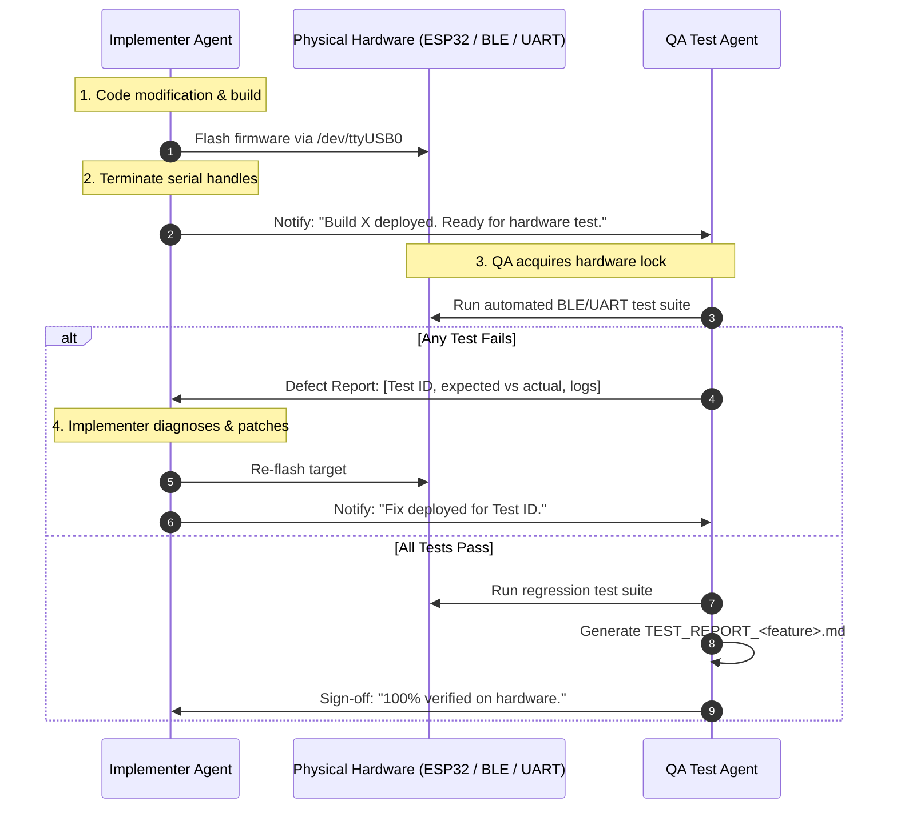

# VCI TDD Dual-Agent Engineering Framework (`vci-tdd-team`)

This skill defines the autonomous collaboration protocol between two specialized roles for the **ESP32-OBD-VCI** project:
1. **Firmware Implementer Agent**
2. **Hardware QA & Test Engineer Agent**

Together, they execute features under an iterative **Test-Driven Development (TDD) Hardware Loop**: Implement $\rightarrow$ Flash $\rightarrow$ Test on Hardware $\rightarrow$ Analyze $\rightarrow$ Patch $\rightarrow$ Repeat until 100% PASS.

---

## 1. Division of Responsibilities

### Role A: Firmware Implementer Agent
- **Ownership:** Firmware codebase under `src/` (`ble_nus.c`, `ble_nus.h`, `dpdu_protocol.c`, `dpdu_protocol.h`, `can_hal.c`, `ecu_sim.c`, `main.c`, `vci_config.h`).
- **Tasks:**
  1. Inspect requirements in `feature_planning.md` or user specifications.
  2. Implement C firmware logic adhering to Apache NimBLE, ESP-IDF v5, and ISO 22900-2 D-PDU standards.
  3. Compile with `pio run -e esp32dev`.
  4. Flash the ESP32 board over `/dev/ttyUSB0` (`pio run -e esp32dev -t upload`).
  5. **Crucial:** Immediately release `/dev/ttyUSB0` and any serial monitor tasks so the Hardware QA Agent can access the port and BLE without contention.
  6. Message the Hardware QA Agent with details of the deployed build.

### Role B: Hardware QA & Test Engineer Agent
- **Ownership:** Host Python test scripts under `tests/` (`test_phase*.py`, `test_<feature>.py`) and test reports (`TEST_REPORT_*.md`).
- **Tasks:**
  1. Translate OEM specification clauses into strict automated hardware test cases.
  2. Author or update the Python test suite using `BleakClient`, `BleakScanner`, `LeanDpduBleClient`, and `LeanDpduSerialClient`.
  3. Ensure unbuffered output (`flush=True`) and progress tracking during long sleep/inactivity verification windows.
  4. Execute test suites against the live target (`A4:F0:0F:77:87:CE` / `/dev/ttyUSB0`).
  5. **If ANY test fails:** Capture raw D-Bus/BLE errors, serial logs, and measured parameters, and deliver an actionable defect report back to the Implementer Agent.
  6. **When all tests pass:** Run regression verification across previous milestones, generate the comprehensive markdown test report (`TEST_REPORT_<name>.md`), and sign off.

---

## 2. Hardware Resource Handshake Protocol

Because the ESP32 hardware and host Bluetooth controller have physical resource constraints:
- `/dev/ttyUSB0` can only be held by one process at a time.
- The ESP32 BLE peripheral permits **at most 1 active GATT connection**.

The two agents MUST operate in a sequential, ping-pong sequence:

---

## 3. Invocation Guidelines

When the user asks to use `vci-tdd-team` (or says "implement with implementer and tester"):
1. Activate this framework.
2. Partition the target task into:
   - Specific firmware changes (Implementer).
   - Test case definitions and assertions (QA Tester).
3. Execute the closed loop until all test cases pass.
4. Conclude by staging all changes, committing, and pushing to `origin/main` as required by repository rules.
