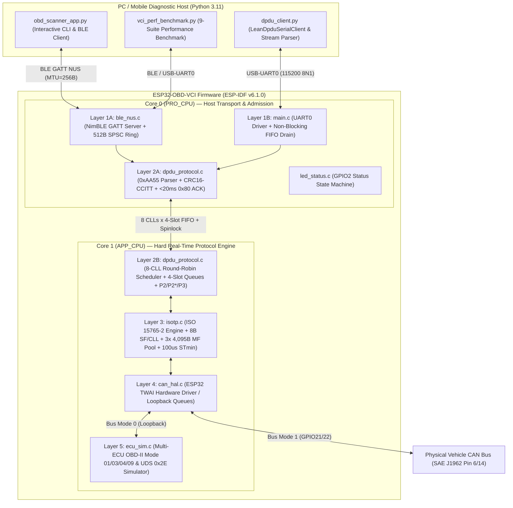
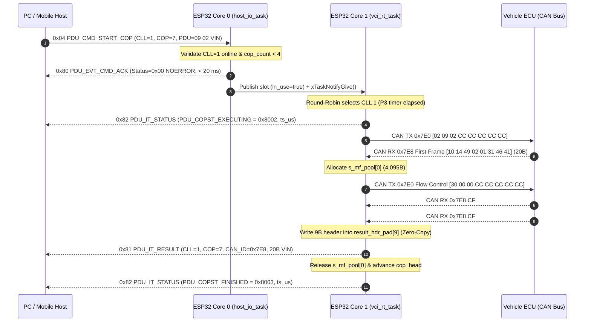

# ESP32-OBD-VCI — Software Design Document (SDD) & Engineering Lessons Guide

- **Project:** ESP32 ISO 22900-2:2022 (`D-PDU API`) & ISO 15765-4 (`OBD-II / UDS on CAN`) Vehicle Communication Interface
- **Target MCU / Framework:** Espressif ESP32 (`Xtensa Dual-Core LX6 @ 240 MHz`, `320 KB` SRAM, `4 MB` Flash) on **ESP-IDF `v6.1.0`**
- **Firmware Version:** `FW v2.1.0` (`0x00020100`) / `HW v1.0.0` (`0x00010000`)
- **Static Memory Footprint:** `45,428 bytes` RAM (`13.9%` of `327,680 B` DRAM) | `500,577 bytes` Flash (`47.7%` of `1 MB` partition)

---

## Table of Contents

### Part I — Software Architecture & Detailed Design
1. [System Context & 5-Layer Software Architecture](#1-system-context--5-layer-software-architecture)
2. [Hardware Pinout, FreeRTOS Task Topology & Dual-Core Assignment](#2-hardware-pinout-freertos-task-topology--dual-core-assignment)
3. [Detailed Module-by-Module Software Design (ESP32 Firmware)](#3-detailed-module-by-module-software-design-esp32-firmware)
   - [3.1 `main.c` — Dual-Core Orchestrator, Host I/O & Zero-Copy Wire Transmitter](#31-mainc--dual-core-orchestrator-host-io--zero-copy-wire-transmitter)
   - [3.2 `ble_nus.c` / `ble_nus.h` — Layer 1 Wireless Transport (NimBLE GATT NUS)](#32-ble_nusc--ble_nush--layer-1-wireless-transport-nimble-gatt-nus)
   - [3.3 `dpdu_protocol.c` / `dpdu_protocol.h` — Layer 2 ISO 22900-2 `App-Device IF` Engine](#33-dpdu_protocolc--dpdu_protocolh--layer-2-iso-22900-2-app-device-if-engine)
   - [3.4 `isotp.c` / `isotp.h` — Layer 3 ISO 15765-2 (`ISO-TP`) Segmentation & Reassembly Engine](#34-isotpc--isotph--layer-3-iso-15765-2-iso-tp-segmentation--reassembly-engine)
   - [3.5 `can_hal.c` / `can_hal.h` — Layer 4 CAN Hardware Abstraction Layer (`TWAI` + Loopback)](#35-can_halc--can_halh--layer-4-can-hardware-abstraction-layer-twai--loopback)
   - [3.6 `ecu_sim.c` / `ecu_sim.h` — Layer 5 Multi-ECU OBD-II & UDS Vehicle Simulator](#36-ecu_simc--ecu_simh--layer-5-multi-ecu-obd-ii--uds-vehicle-simulator)
   - [3.7 `led_status.c` / `led_status.h` — Visual Diagnostic State Indicator](#37-led_statusc--led_statush--visual-diagnostic-state-indicator)
4. [Binary Wire Protocol Design (`App-Device IF` `0xAA55` Framing)](#4-binary-wire-protocol-design-app-device-if-0xaa55-framing)
5. [Static Memory Budget & Zero-Copy Buffer Architecture](#5-static-memory-budget--zero-copy-buffer-architecture)
6. [Core State Machines & End-to-End Sequence Diagrams](#6-core-state-machines--end-to-end-sequence-diagrams)
7. [PC Host Diagnostic Software Design (`pc_app/`)](#7-pc-host-diagnostic-software-design-pc_app)

### Part II — Engineering Lessons Learned & Technical Recommendations
8. [Bluetooth LE (NimBLE GATT NUS) Lessons Learned](#8-bluetooth-le-nimble-gatt-nus-lessons-learned)
9. [USB-UART0 High-Speed Binary Framing Lessons Learned](#9-usb-uart0-high-speed-binary-framing-lessons-learned)
10. [ISO 22900-2:2022 (`App-Device IF`) Queue & Concurrency Lessons](#10-iso-22900-22022-app-device-if-queue--concurrency-lessons)
11. [ISO 15765-2 (`ISO-TP`) & Sub-Millisecond Timer Precision Lessons](#11-iso-15765-2-iso-tp--sub-millisecond-timer-precision-lessons)
12. [Host Transport Mitigation Strategies (Pipelining vs. Cyclic COP)](#12-host-transport-mitigation-strategies-pipelining-vs-cyclic-cop)
13. [Summary Checklist for Future VCI Designers](#13-summary-checklist-for-future-vci-designers)

---

# Part I — Software Architecture & Detailed Design

## 1. System Context & 5-Layer Software Architecture

The **ESP32-OBD-VCI** implements an automotive-grade **ISO 22900-2:2022 (`D-PDU API`) Application-to-Device Interface (`App-Device IF`)** bridging a PC or Mobile Diagnostic Tester (over **Bluetooth LE GATT NUS** or **USB-UART0**) to a vehicle's **ISO 11898 Classic CAN 2.0B** network (`11-bit` and `29-bit` identifiers at `125k`, `250k`, `500k`, or `1000k` bps).



---

## 2. Hardware Pinout, FreeRTOS Task Topology & Dual-Core Assignment

### 2.1 Hardware Pin & Peripheral Mapping (`src/vci_config.h`)

| Peripheral / Function | ESP32 GPIO / Resource | Configuration | Purpose |
| :--- | :---: | :---: | :--- |
| **Host Wired Serial (`UART0`)** | `GPIO1` (TX), `GPIO3` (RX) | `115200` baud, `8N1`, `2048 B` RX/TX ring | Wired `0xAA55` D-PDU host interface |
| **Host Wireless (`Bluetooth LE`)** | Internal 2.4 GHz Radio | NimBLE GATT NUS (`ATT MTU = 256 B`) | Wireless `0xAA55` D-PDU host interface |
| **Physical CAN Bus (`TWAI`)** | `GPIO21` (TX), `GPIO22` (RX) | `125k / 250k / 500k / 1M` bps | External CAN transceiver (`SN65HVD230`) |
| **Diagnostic Status LED** | `GPIO2` | Push-Pull Digital Output | Visual link & CAN activity indicator |
| **High-Resolution Timer** | `esp_timer` (64-bit HW) | `1 µs` tick (`100 µs` D-PDU resolution) | `Rx_Timestamp_us`, `P2`, `P2*`, `P3`, `N_Bs`, `N_Cr` |

### 2.2 FreeRTOS Multi-Core Task Architecture

| Task Name | Source File | Pinned Core | Priority | Stack Size | Responsibility |
| :--- | :--- | :---: | :---: | :---: | :--- |
| **`ble_nus_host_task`** | `src/ble_nus.c` | Core 0 (`PRO_CPU`) | NimBLE Default | `4096 B` | Runs `nimble_port_run()`, GAP advertising (`20–40 ms`), GATT ATT server, and pushes incoming RX bytes into `s_ble_rx_ring[512]` |
| **`host_io`** | `src/main.c` | Core 0 (`PRO_CPU`) | `10` (`VCI_PRIO_HOST_IO_TASK`) | `4096 B` | Drains `s_ble_rx_ring` and `UART0`, runs `dpdu_parser_feed_byte()`, validates CRC-16, admits commands into CLL queues, and emits `< 20 ms` synchronous `0x80` `CMD_ACK`/`NACK` |
| **`led_status`** | `src/led_status.c` | Core 0 (`PRO_CPU`) | `3` (`VCI_PRIO_LED_TASK`) | `2048 B` | Drives `GPIO2` LED patterns (`DISCONNECTED` slow blink, `CONNECTED_IDLE` solid ON, `CAN_ACTIVE` fast strobe, `FAULT` double-flash) |
| **`vci_rt`** | `src/main.c` | Core 1 (`APP_CPU`) | `18` (`VCI_PRIO_VCI_RT_TASK`) | `4096 B` | Executes `dpdu_engine_step_round_robin()` across all 8 CLLs, drives ISO 15765-2 `FF`/`FC`/`CF` state machines, enforces `P2`/`P2*`/`P3`/`N_Bs`/`N_Cr` timers, and services autonomous `PDUDestruct` |
| **`ecu_sim`** | `src/ecu_sim.c` | Core 1 (`APP_CPU`) | `19` (`VCI_PRIO_ECU_SIM_TASK`) | `4096 B` | Simulates up to 4 physical ECUs (`0x7E0..0x7E3 -> 0x7E8..0x7EB`) + `11-bit` (`0x7DF`) and `29-bit` (`0x18DB33F1 -> 0x18DAF110`) functional OBD-II & UDS responders |

---

## 3. Detailed Module-by-Module Software Design (ESP32 Firmware)

### 3.1 `main.c` — Dual-Core Orchestrator, Host I/O & Zero-Copy Wire Transmitter
- **State Managed:**
  - `s_vci_state` (`dpdu_vci_state_t`): Global 8-CLL D-PDU engine instance.
  - `s_ble_parser` & `s_uart_parser` (`dpdu_rx_parser_t`): Independent `0xAA55` stream parsers for BLE and UART0 so simultaneous activity never corrupts parser state.
  - `s_ble_rx_ring[512]`, `s_ble_rx_head`, `s_ble_rx_tail`: Lock-free single-producer (`on_ble_nus_rx`) / single-consumer (`host_io_task`) ringbuffer decoupling NimBLE GATT callbacks from packet processing.
  - `s_host_tx_mutex` (`SemaphoreHandle_t`): Mutex serializing outgoing VCI→Host frames emitted concurrently by Core 0 (`0x80` `CMD_ACK`) and Core 1 (`0x81` `PDU_IT_RESULT`, `0x82` `PDU_IT_STATUS`, `0x83` `PDU_IT_ERROR`).
- **Zero-Copy Large Packet Transmitter (`host_send_packet`):**
  - Small packets (`payload_len <= 256 B`) are encoded into a static `266 B` `small_wire` buffer via `dpdu_encode_packet()` and sent atomically.
  - Large Multi-Frame packets (`payload_len > 256 B`, up to `4,104 B`) compute the `CRC16-CCITT` in-place over `[8B Header]` + `[In-Place Pool Payload]` and stream `[Header (8B)]`, `[Payload (N B)]`, and `[CRC (2B)]` directly to `uart_write_bytes()` and `ble_nus_send()` without allocating a `4.1 KB` contiguous wire buffer.

### 3.2 `ble_nus.c` / `ble_nus.h` — Layer 1 Wireless Transport (NimBLE GATT NUS + LE Security Mode 1, Level 2)
- **GATT Service Table (`s_gatt_nus_svcs`):**
  - **Primary Service UUID:** `6E400001-B5A3-F393-E0A9-E50E24DCCA9E` (Nordic UART Service).
  - **RX Characteristic (`6E400002-...`):** `BLE_GATT_CHR_F_WRITE | BLE_GATT_CHR_F_WRITE_NO_RSP | BLE_GATT_CHR_F_WRITE_ENC` (Host → VCI commands; enforces **LE Security Mode 1, Level 2** encrypted link).
  - **TX Characteristic (`6E400003-...`):** `BLE_GATT_CHR_F_NOTIFY` (VCI → Host synchronous ACKs and asynchronous Result/Status/Error Event Items; gated by `ble_nus_is_encrypted()`).
- **LE Security Mode 1, Level 2 (Unauthenticated Pairing + AES-CCM Encryption + NVS Bonding):**
  - Configured in `ble_nus_init()` via `ble_hs_cfg`: `sm_io_cap = BLE_HS_IO_NO_INPUT_OUTPUT` ("Just Works"), `sm_bonding = 1`, `sm_mitm = 0`, `sm_sc = 1` (LE Secure Connections ECDH P-256 with Legacy fallback), `sm_our_key_dist = BLE_SM_PAIR_KEY_DIST_ENC | BLE_SM_PAIR_KEY_DIST_ID`, and `ble_store_config_init()` (`CONFIG_BT_NIMBLE_NVS_PERSIST=y` in `sdkconfig.esp32dev`).
  - Handles `BLE_GAP_EVENT_ENC_CHANGE` (updates `s_conn_encrypted`) and `BLE_GAP_EVENT_REPEAT_PAIRING` (deletes stale peer bond via `ble_store_util_delete_peer(&desc.peer_id_addr)` and returns `BLE_GAP_REPEAT_PAIRING_RETRY`).
  - Inside `gatt_nus_chr_access()`, explicitly verifies `desc.sec_state.encrypted` on every `BLE_GATT_ACCESS_OP_WRITE_CHR` (since `Write Without Response` bypasses ATT-level error responses unless checked in the access callback) and triggers `ble_gap_security_initiate(conn_handle)` + `BLE_ATT_ERR_INSUFFICIENT_ENC` if unencrypted.
- **GAP Advertising & Connection Management:**
  - Advertises device name `ESP32-OBD-VCI` in the primary advertisement packet and the 128-bit NUS UUID in the scan response packet (`20–40 ms` advertising interval, discovered in `49.9 ms` average).
  - On `BLE_GAP_EVENT_CONNECT`, immediately initiates `ble_gattc_exchange_mtu(s_conn_hdl, NULL, NULL)` (`256 B` preferred MTU).
  - On `BLE_GAP_EVENT_DISCONNECT`, invokes `on_ble_nus_disconnect()` to trigger `< 100 ms` autonomous `PDUDestruct` (`48.4 ms` measured) and restarts advertising.
- **Chunked Notification Transmitter (`ble_nus_send`):**
  - Splits outgoing frames into `max_chunk = min(mtu - 3, 240)` byte notifications and retries up to 5 times with a 1-tick backoff if `ble_hs_mbuf_from_flat()` or `ble_gatts_notify_custom()` returns `BLE_HS_ENOMEM`.

### 3.3 `dpdu_protocol.c` / `dpdu_protocol.h` — Layer 2 ISO 22900-2 `App-Device IF` Engine
- **8 ComLogicalLinks (`dpdu_cll_t clls[8]`):**
  - Each CLL (`CLL_ID = 1..8`) maintains its own `online` state, 13 ISO 22900-2 Annex B ComParams, `next_allowed_tx_us` (`P3_Phys` / `P3_Func` deadline), dedicated `8-byte` Single-Frame RX buffer (`sf_rx_buf[8]`), and **4-slot ComPrimitive FIFO ring queue** (`cop_queue[4]`).
- **Baudrate Locking (`locked_baudrate_bps`):**
  - The first CLL to transition to `PDU_CLLST_ONLINE` via `PDU_CMD_CONNECT` (`0x01`) starts the CAN controller (`can_hal_start()`) and locks the physical CAN bitrate (`125k`, `250k`, `500k`, or `1M` bps). Any subsequent CLL attempting to connect or `SetComParam(CP_BAUDRATE)` with a conflicting bitrate while other CLLs are online is rejected with `0x80` NACK (`PDU_ERR_BAUDRATE_CONFLICT = 0x05`).
- **Synchronous Command Admission (`dpdu_engine_handle_host_cmd` on Core 0):**
  - Processes all 8 Host→VCI opcodes (`0x01..0x08`) and emits a synchronous `0x80` `PDU_EVT_CMD_ACK` within `< 20 ms` (`3.93 ms` on UART).
  - When a `PDU_CMD_START_COP` (`0x04`) arrives and the target CLL already has 4 queued ComPrimitives (`cop_count >= 4`), it immediately rejects the 5th command with `0x80` NACK (`PDU_ERR_COMM_PC_TO_VCI_OVERRUN = 0x03`).
- **Core 1 Round-Robin Scheduler (`dpdu_engine_step_round_robin`):**
  - Rotates `rr_cll_idx` (`0..7`) across all 8 CLLs.
  - Skips any CLL whose `next_allowed_tx_us` (`P3_Phys` / `P3_Func`) or `next_cycle_tx_us` (for periodic cyclic primitives) has not yet elapsed, allowing other ready CLLs to transmit immediately without head-of-line blocking.
  - Emits `0x82 PDU_IT_STATUS (PDU_COPST_EXECUTING)` on the first cycle, executes the ISO-TP transaction (`execute_single_cop_cycle`), emits `0x81 PDU_IT_RESULT` (or `0x83 PDU_IT_ERROR`), and emits `0x82 PDU_IT_STATUS (PDU_COPST_FINISHED)` when all `num_send_cycles` complete.

### 3.4 `isotp.c` / `isotp.h` — Layer 3 ISO 15765-2 (`ISO-TP`) Segmentation & Reassembly Engine
- **Single-Frame (`SF`) vs. Multi-Frame (`MF`) Routing (`isotp_rx_feed_frame`):**
  - **CAN ID Filtering:** Accepts `cfg->can_resp_id` in physical mode; in functional mode (`CP_ADDRESSING_TYPE = 0`), accepts standard `11-bit` OBD-II ECU responses (`0x7E8..0x7EF`) or `29-bit` ISO 15765-4 functional responses (`0x18DAF100..0x18DAF1FF`).
  - **Single Frame (`PCI = 0x01..0x07`):** Copies the `1..7` payload bytes directly into the CLL's dedicated `ctx->cll_sf_buf[8]` and returns `ISOTP_RX_COMPLETE`.
  - **First Frame (`PCI = 0x10..0x1F`):** Extracts the 12-bit payload length (`8..4095 B`), allocates one of the **3 shared `4,095 B` Multi-Frame RX buffers (`s_mf_pool[3]`)**, copies the first 6 bytes, derives the physical Flow Control TX CAN ID (`rx_id - 8` for `11-bit`, or byte-swapped target/source `0x18DA..` for `29-bit`), and transmits `FC(CTS=0x30, BS=cfg->fc_bs, STmin=cfg->fc_stmin)` padded with `CP_CAN_FILLER_BYTE`.
  - **Consecutive Frame (`PCI = 0x20..0x2F`):** Verifies the modulo-16 sequence number (`next_sn`), appends up to 7 bytes into `mf->data`, transmits intermediate Flow Control frames if `CP_BLOCK_SIZE > 0`, and returns `ISOTP_RX_COMPLETE` once `offset >= total_len`.
- **Multi-Frame Tester → ECU TX (`isotp_send_pdu`):**
  - For `pdu_len <= 7 B`, transmits a single CAN frame padded with `CP_CAN_FILLER_BYTE`.
  - For `8..4095 B`, transmits the First Frame (`FF`), awaits the ECU's Flow Control (`FC`) frame within `CP_N_BS_MS` (`1000 ms`), converts the ECU's `STmin` via `isotp_stmin_to_us()` (`100 µs` resolution), and transmits Consecutive Frames (`CF`) spaced by `STmin`.

### 3.5 `can_hal.c` / `can_hal.h` — Layer 4 CAN Hardware Abstraction Layer (`TWAI` + Loopback)
- Provides a unified `can_hal_send()` / `can_hal_recv()` interface supporting two runtime bus modes selected via `PDU_CMD_CONNECT`:
  1. **`VCI_BUS_MODE_SIM_LOOPBACK` (`0x00`):** Routes CAN frames through two lock-free FreeRTOS queues (`s_q_tx_to_ecu` and `s_q_rx_from_ecu`, depth 32) connected to `ecu_sim_task` on Core 1.
  2. **`VCI_BUS_MODE_PHYSICAL_CAN` (`0x01`):** Installs and starts the ESP32 hardware TWAI controller on `GPIO21` (TX) and `GPIO22` (RX) using ESP-IDF timing macros (`TWAI_TIMING_CONFIG_125KBITS()`, `250KBITS()`, `500KBITS()`, `1MBITS()`) with an accept-all filter so software CLL filtering handles arbitrary `11-bit` and `29-bit` IDs.

### 3.6 `ecu_sim.c` / `ecu_sim.h` — Layer 5 Multi-ECU OBD-II & UDS Vehicle Simulator
- Simulates a realistic multi-ECU vehicle network on Core 1 for hardware-in-the-loop verification without requiring a live vehicle:
  - Responds to `11-bit` physical requests across **4 ECUs** (`0x7E0 -> 0x7E8` ECM, `0x7E1 -> 0x7E9` TCM, `0x7E2 -> 0x7EA` ABS, `0x7E3 -> 0x7EB` BCM), `11-bit` functional broadcast (`0x7DF -> 0x7E8`), and `29-bit` extended functional/physical requests (`0x18DB33F1 / 0x18DA10F1 -> 0x18DAF110`).
  - **Supported Services & Test Hooks:**
    - **Mode `01` Live Telemetry:** `PID 0x00` (`BE 3E B8 13`), `PID 0x0C` (`1726.0 RPM`), `PID 0x0D` (`85 km/h`), `PID 0x05` (`90 °C`), `PID 0x11` (`25.1%` throttle).
    - **Mode `01` Protocol Test Hooks:** `PID 0xF0` emits `7F 01 78` (`ResponsePending`), waits `120 ms`, and emits `41 F0 AB CD` (verifies `P2*` extension); `PID 0xF3` echoes byte 7 of the request (verifies `CP_CAN_FILLER_BYTE`); `PID 0xFF` remains silent (verifies `CP_P2_MAX_MS` timeout).
    - **Mode `03` & Mode `04` DTCs:** Returns 4 stored trouble codes (`P0171`, `P0300`, `C0035`, `U0100`) via a 10-byte Multi-Frame response and clears them on Mode `04`.
    - **Mode `09` Vehicle Info:** `PID 0x02` returns 17-character VIN (`1FAFP40411F192837`, 20-byte Multi-Frame); `PID 0x04` returns Calibration ID (`ESP32_VCI_CAL_01`, 19-byte Multi-Frame); `PID 0xF1` stalls after `FF` (verifies `CP_N_CR_MS` timeout); `PID 0xF2` injects a corrupt CF sequence number (verifies `PDU_ERR_EVT_PROT_ERR`).
    - **UDS `0x2E` (`WriteDataByIdentifier`):** Accepts Multi-Frame Tester→ECU writes to `DID 0xF190` (VIN), updates the simulated VIN in RAM, and returns positive response `6E F1 90`.

---

## 4. Binary Wire Protocol Design (`App-Device IF` `0xAA55` Framing)

Every packet exchanged between the Host and VCI over `USB-UART0` or `Bluetooth LE NUS` uses a unified 8-byte header + variable payload + 2-byte `CRC16-CCITT` (`poly=0x1021, init=0xFFFF`) envelope:

```
 0                   1                   2                   3
 0 1 2 3 4 5 6 7 8 9 0 1 2 3 4 5 6 7 8 9 0 1 2 3 4 5 6 7 8 9 0 1
+-+-+-+-+-+-+-+-+-+-+-+-+-+-+-+-+-+-+-+-+-+-+-+-+-+-+-+-+-+-+-+-+
|      SOF = 0xAA55 (LE)        |   Msg_Type    |    CLL_ID     |
+-+-+-+-+-+-+-+-+-+-+-+-+-+-+-+-+-+-+-+-+-+-+-+-+-+-+-+-+-+-+-+-+
|    COP_ID     |    Status     |      Payload_Len (LE)         |
+-+-+-+-+-+-+-+-+-+-+-+-+-+-+-+-+-+-+-+-+-+-+-+-+-+-+-+-+-+-+-+-+
|                   Payload (0 .. 4,103 Bytes)                  |
+-+-+-+-+-+-+-+-+-+-+-+-+-+-+-+-+-+-+-+-+-+-+-+-+-+-+-+-+-+-+-+-+
|       CRC16-CCITT (LE, over Msg_Type .. end of Payload)       |
+-+-+-+-+-+-+-+-+-+-+-+-+-+-+-+-+-+-+-+-+-+-+-+-+-+-+-+-+-+-+-+-+
```

### 4.1 Complete Command & Event Wire Matrix

| `Msg_Type` | Direction | Name | `CLL_ID` | Request / Event Payload Layout |
| :---: | :---: | :--- | :---: | :--- |
| `0x01` | Host → VCI | `PDU_CMD_CONNECT` | `1..8` | `[Bus_Mode: 1B]` (`0=SimLoopback, 1=PhysicalCAN`) |
| `0x02` | Host → VCI | `PDU_CMD_DISCONNECT` | `1..8` or `0` | Empty (`CLL_ID=0` triggers full `PDUDestruct` across all 8 CLLs) |
| `0x03` | Host → VCI | `PDU_CMD_SET_COMPARAM` | `1..8` | `[Param_ID: 2B LE] [Param_Value: 4B LE]` |
| `0x04` | Host → VCI | `PDU_CMD_START_COP` | `1..8` | `[NumSend: 1B] [NumRecv: 1B] [Cycle_ms: 2B LE] [CAN_ID: 4B LE] [N-PDU: 1..4095B]` |
| `0x05` | Host → VCI | `PDU_CMD_CANCEL_COP` | `1..8` | Empty (`COP_ID=1..255` cancels one primitive; `COP_ID=0` drains all 4 slots) |
| `0x06` | Host → VCI | `PDU_CMD_GET_STATUS` | `1..8` | Empty; `0x80` ACK returns `[OnlineMask(1B)|Mode(1B)|Baud_kHz(2B)|RxCnt(4B)|CrcErr(2B)|Uptime_ms(4B)|ReqID(2B)]` |
| `0x07` | Host → VCI | `PDU_CMD_GET_COMPARAM` | `1..8` | `[Param_ID: 2B LE]`; `0x80` ACK returns `[Param_ID(2B LE)|Param_Val(4B LE)]` |
| `0x08` | Host → VCI | `PDU_CMD_MOD_CTRL` | `0x00` | `[IOCTL_ID: 2B LE]` (`0x0001`=VBATT, `0x0002`=CableID, `0x0003`=GetVersion) |
| `0x80` | VCI → Host | `PDU_EVT_CMD_ACK` | Echoed | Synchronous `< 20 ms` ACK/NACK (`Status` in byte 5: `0x00`=OK, `0x03`=Queue Overrun, `0x04`=Unsupported, `0x05`=Baudrate Conflict) |
| `0x81` | VCI → Host | `PDU_IT_RESULT` | `1..8` | `[Rx_Timestamp_us: 4B LE] [Rx_CAN_ID: 4B LE] [Extra_Addr: 1B] [N-PDU: 1..4095B]` |
| `0x82` | VCI → Host | `PDU_IT_STATUS` | `1..8` | `[Event_Timestamp_us: 4B LE] [Status_Code: 2B LE]` (`0x8002`=EXECUTING, `0x8003`=FINISHED, `0x8004`=CANCELLED, `0x8010`=OFFLINE, `0x8011`=ONLINE) |
| `0x83` | VCI → Host | `PDU_IT_ERROR` | `1..8` | `[Error_Timestamp_us: 4B LE] [Error_Code: 2B LE] [Vendor_SubCode: 2B LE]` |

---

## 5. Static Memory Budget & Zero-Copy Buffer Architecture

The entire VCI firmware uses **deterministic static allocation (`.bss` / `.data`)** with zero `malloc()`/`free()` in the diagnostic path:

| Static Structure | Location | Calculation | Size (`Bytes`) | Purpose |
| :--- | :--- | :--- | ---: | :--- |
| **3× Multi-Frame RX Pool (`s_mf_pool`)** | `src/isotp.c` | `3 × sizeof(isotp_mf_buf_t)` | `12,348 B` | Reassembles up to 3 concurrent `4,095 B` ISO-TP responses + `9 B` in-place result header padding |
| **8× CLL Contexts (`s_vci_state`)** | `src/main.c` | `8 × sizeof(dpdu_cll_t)` | `3,296 B` | 8 CLLs × (13 ComParams + `8 B` SF buffer + `4 × 88 B` COP queue slots) |
| **BLE & UART Stream Parsers** | `src/main.c` | `2 × sizeof(dpdu_rx_parser_t)` | `192 B` | `72 B` inline command buffer per parser; borrows `s_mf_pool[2]` for rare `> 64 B` TX |
| **BLE SPSC RX Ringbuffer (`s_ble_rx_ring`)** | `src/main.c` | `512 × 1 B` | `512 B` | Lock-free decoupling buffer between NimBLE GATT RX callback and `host_io_task` |
| **Small Wire TX Buffer (`small_wire`)** | `src/main.c` | `8 + 256 + 2 B` | `266 B` | Encodes packets `<= 256 B`; packets `> 256 B` stream in-place from `s_mf_pool` |
| **ESP-IDF Kernel, NimBLE & UART Rings** | ESP-IDF `.bss`/`.data` | FreeRTOS + NimBLE + TWAI | `28,814 B` | Bluetooth LE stack, FreeRTOS TCBs, and UART0 `2 KB` RX/TX ringbuffers |
| **Total Static RAM Used** | **`.bss` + `.data`** | **`13.9%` of `327,680 B` DRAM** | **`45,428 B`** | Leaves `> 282 KB` free DRAM headroom |

---

## 6. Core State Machines & End-to-End Sequence Diagrams

### 6.1 ComPrimitive Lifecycle & Pipelined Execution Sequence



---

## 7. PC Host Diagnostic Software Design (`pc_app/`)

| Module | Primary Classes / Functions | Role in System |
| :--- | :--- | :--- |
| **[`pc_app/dpdu_client.py`](file:///home/abey/Documents/obd_scanner/pc_app/dpdu_client.py)** | [`DpduFrame`](file:///home/abey/Documents/obd_scanner/pc_app/dpdu_client.py#L140-L185), [`DpduStreamParser`](file:///home/abey/Documents/obd_scanner/pc_app/dpdu_client.py#L188-L256), [`LeanDpduSerialClient`](file:///home/abey/Documents/obd_scanner/pc_app/dpdu_client.py#L258-L460) | Implements the `0xAA55` + `CRC16-CCITT` wire encoder/decoder, non-blocking `USB-UART0` client, and the 25-test hardware verification suite (`--step2`, `--step3`, `--iso22900`, `--all`). |
| **[`pc_app/obd_scanner_app.py`](file:///home/abey/Documents/obd_scanner/pc_app/obd_scanner_app.py)** | [`LeanDpduBleClient`](file:///home/abey/Documents/obd_scanner/pc_app/obd_scanner_app.py#L140-L376), [`AsyncSerialVciAdapter`](file:///home/abey/Documents/obd_scanner/pc_app/obd_scanner_app.py#L379-L483), [`run_interactive_scanner`](file:///home/abey/Documents/obd_scanner/pc_app/obd_scanner_app.py#L781-L934) | Full-featured dual-transport (`--ble` & `--use-serial`) diagnostic scanner application featuring the VCI Hardware/Battery Dashboard (`VBATT`, `CableID`, `FW/HW`), Supported PID Decoder, Autonomous Cyclic Streamer, UDS `0x2E` VIN Programmer, Multi-ECU (`CLL 1..4`) Scanner, and 13-ComParam Inspector/Tuner. |
| **[`pc_app/vci_perf_benchmark.py`](file:///home/abey/Documents/obd_scanner/pc_app/vci_perf_benchmark.py)** | [`run_uart_benchmarks`](file:///home/abey/Documents/obd_scanner/pc_app/vci_perf_benchmark.py#L439-L619), [`run_ble_benchmarks`](file:///home/abey/Documents/obd_scanner/pc_app/vci_perf_benchmark.py#L622-L982), [`generate_markdown_report`](file:///home/abey/Documents/obd_scanner/pc_app/vci_perf_benchmark.py#L75-L436) | Automated 9-category side-by-side benchmark harness generating [`VCI_PERFORMANCE_REPORT.md`](file:///home/abey/Documents/obd_scanner/VCI_PERFORMANCE_REPORT.md). |

---

# Part II — Engineering Lessons Learned & Technical Recommendations

## 8. Bluetooth LE (NimBLE GATT NUS) Lessons Learned

### Lesson 8.1: Never Modify `ctxt->om` In-Place Inside a NimBLE GATT Write Callback
- **Symptom Observed:** During sustained BLE stress testing (`[BLE 3/9]` in `vci_perf_benchmark.py`), the BLE connection reliably dropped on the **25th GATT write** (`12 iterations × 2 writes/iteration = 24 writes`), whereas shorter tests (8–15 writes) passed without issue.
- **Root Cause:** In NimBLE (`ble_att_svr.c`), when a GATT Characteristic Write (`BLE_GATT_ACCESS_OP_WRITE_CHR`) arrives, NimBLE passes a chained `os_mbuf` via `ctxt->om` to the application's `access_cb` (`gatt_nus_chr_access` in `src/ble_nus.c`). After `access_cb` returns, NimBLE frees the incoming buffer by calling `os_mbuf_free_chain(ctxt.om)`.
  - Advancing `ctxt->om = SLIST_NEXT(ctxt->om, om_next);` directly set `ctxt->om` to `NULL` by the end of the loop.
  - When `gatt_nus_chr_access` returned `0`, NimBLE called `os_mbuf_free_chain(NULL)` (a no-op), **leaking one `os_mbuf` on every single GATT write**.
  - Because ESP-IDF's default NimBLE `msys_1` pool has **24 blocks**, the 25th GATT write exhausted the pool and dropped the BLE connection.
- **Technical Fix:** Always iterate over `ctxt->om` using a local `const struct os_mbuf *cur = ctxt->om;` pointer so `ctxt->om` remains pointing to the head of the chain when returning to NimBLE:
  ```c
  const struct os_mbuf *cur = ctxt->om;
  while (cur != NULL) {
      s_rx_cb(cur->om_data, cur->om_len);
      cur = SLIST_NEXT(cur, om_next);
  }
  ```

### Lesson 8.2: Decouple GATT RX Callbacks from Outgoing GATT TX Notifications
- **Symptom Observed:** Calling `ble_gatts_notify_custom()` synchronously from inside `gatt_nus_chr_access()` creates re-entrant contention on NimBLE's internal host lock and mbuf pool during rapid `Write Without Response` bursts.
- **Technical Fix:** Enqueue incoming BLE bytes into a lock-free SPSC ringbuffer (`s_ble_rx_ring[512]` in `src/main.c`) inside `on_ble_nus_rx()` and wake `host_io_task` via `xTaskNotifyGive()`.
  - `gatt_nus_chr_access()` completes in `< 2 µs` and immediately returns control to NimBLE so the RX `os_mbuf` is freed right away.
  - `host_io_task` parses the `0xAA55` frame and invokes `ble_nus_send()` cleanly outside the NimBLE ATT callback context.

### Lesson 8.3: Initiate ATT MTU Exchange from the Peripheral (`ble_gattc_exchange_mtu`)
- **Symptom Observed:** On Linux (`BlueZ` + `Bleak`), reconnecting to a cached BLE device often skips GATT service discovery and leaves the ATT MTU at the default `23 bytes` (`20-byte` payload per notification), fragmenting `26-byte` `PDUGetVersion` ACKs and `39-byte` Multi-Frame VIN Results.
- **Technical Fix:** Call `ble_gattc_exchange_mtu(event->connect.conn_handle, NULL, NULL);` inside `BLE_GAP_EVENT_CONNECT` on the ESP32 peripheral (`src/ble_nus.c`) to guarantee a `256-byte` ATT MTU (`240-byte` chunk size) on every connection.

### Lesson 8.4: Wireless Link-Loss Safety (`PDUDestruct < 100 ms`)
- **Requirement (ISO 22900-2):** If a wireless diagnostic session drops while cyclic or multi-frame ComPrimitives are active on the vehicle CAN bus, the VCI must autonomously abort all in-flight CAN activity and transition all CLLs to `PDU_CLLST_OFFLINE` within `< 100 ms`.
- **Implementation Pattern:** In `BLE_GAP_EVENT_DISCONNECT`, set `cancel_requested = true` across all 8 CLLs × 4 queue slots, set `s_ble_destruct_pending = true`, and immediately wake `vci_rt_task` on Core 1 via `xTaskNotifyGive()`. Hardware benchmarks confirmed full autonomous teardown in **`48.4 ms`** (`< 100 ms` target).

### Lesson 8.5: LE Security Mode 1, Level 2 ("Just Works" Encryption) & BlueZ D-Bus Agent Pitfalls
- **Architectural Requirement:** Because `ESP32-OBD-VCI` is a headless vehicle dongle with no display or keypad (`BLE_HS_IO_NO_INPUT_OUTPUT`), **LE Security Mode 1, Level 2** (*Unauthenticated Pairing with AES-CCM Encryption — "Just Works" + NVS Bonding*) is the highest Bluetooth Core Spec security level achievable without out-of-band/static passkey entry.
- **Pitfall 1 (`Write Without Response` Bypasses ATT Flag Checks Unless Verified in Callback):**
  - Setting `BLE_GATT_CHR_F_WRITE_ENC` on the NUS RX characteristic causes NimBLE to return `BLE_ATT_ERR_INSUFFICIENT_ENC (0x0F)` on an `ATT Write Request` (`response=True`), which triggers SMP pairing on the Central. However, `ATT Write Command` (`Write Without Response`, `response=False`) has no ATT error response PDU. Always verify `desc.sec_state.encrypted` inside `gatt_nus_chr_access()` and inside `ble_nus_send()` so unencrypted `Write Without Response` frames are never admitted into the D-PDU engine.
- **Pitfall 2 (Peripheral-Initiated `Security Request` at `t = 0 ms` Collides with BlueZ GATT Discovery):**
  - Calling `ble_gap_security_initiate(s_conn_hdl)` synchronously inside `BLE_GAP_EVENT_CONNECT` sends an unsolicited SMP `Security Request` while Linux `BlueZ` is still performing initial GATT Primary Service Discovery, causing BlueZ to invoke `org.bluez.Agent1.RequestAuthorization` on the desktop GUI (timing out after 30 seconds on headless CLI runs) or dropping service discovery.
  - **Best Practice:** Let `connect()` complete GATT discovery cleanly, register a lightweight `NoInputNoOutput` `org.bluez.Agent1` via `dbus_fast` on Linux hosts (`ensure_bluez_just_works_agent()`), and trigger `await client.pair()` (or GATT write encryption elevation) immediately after `connect()`. Enable `CONFIG_BT_NIMBLE_NVS_PERSIST=y` (`ble_store_config_init()`) so subsequent connections re-encrypt in `< 50 ms` using the NVS-persisted LTK.

---

## 9. USB-UART0 High-Speed Binary Framing Lessons Learned

### Lesson 9.1: Silence Runtime `ESP_LOG*` on Shared Binary UART Channels
- **Symptom Observed:** When `UART0` carries binary `0xAA55` D-PDU packets, any asynchronous `ESP_LOGI()` / `ESP_LOGW()` output injects ASCII bytes into binary `0xAA55` frames, triggering `PDU_ERR_CRC_MISMATCH` (`0x0004`) or `PDU_ERR_MALFORMED_FRAME` (`0x0005`).
- **Technical Fix:** Call `esp_log_level_set("*", ESP_LOG_NONE);` at the start of `app_main()` in `src/main.c`.

### Lesson 9.2: Avoid Fixed-Size Block Reads (`read(256)`) with Multi-Millisecond Timeouts
- **Symptom Observed:** Initial USB-UART0 benchmarks showed a uniform **`22.17 ms`** latency for a 10-byte `IOCTL_READ_VBATT` command even though 24 total bytes (`10 B` TX + `14 B` RX) at `115200` baud require only `2.08 ms` on the wire.
- **Root Cause (Both Host and MCU):**
  1. **Host (`pyserial`):** Calling `self.ser.read(256)` with `timeout = 0.02` (`20 ms`) receives the 14-byte response in `2 ms`, and then **blocks for the remaining `18 ms`** waiting for 242 more bytes until the `20 ms` timeout expires.
  2. **ESP32 (`uart_read_bytes`):** Calling `uart_read_bytes(UART_NUM_0, rx_chunk, 256, pdMS_TO_TICKS(5))` loops internally until either all `256` bytes are read or the full tick timeout expires.
- **Technical Fix:**
  - **Host (`pc_app/dpdu_client.py`):** Query `n_avail = self.ser.in_waiting` and call `self.ser.read(n_avail if n_avail > 0 else 1)`.
  - **ESP32 (`src/main.c`):** Query `uart_get_buffered_data_len()` first and read the exact buffered byte count with a `0`-tick timeout; only block for `1 byte` (`uart_read_bytes(..., 1, 1)`) when the RX FIFO is empty.
  - **Result:** USB-UART0 synchronous IOCTL latency dropped from **`22.17 ms` to `3.93 ms` (`5.6×` faster)**, single-frame OBD-II RTT dropped from **`23.89 ms` to `9.00 ms`**, and sustained wire throughput reached **`691.2 pkt/s` (`111.69 kbps` — 97% of the `115.2 kbps` 8N1 line rate)**.

---

## 10. ISO 22900-2:2022 (`App-Device IF`) Queue & Concurrency Lessons

### Lesson 10.1: Emit `0x80` `CMD_ACK` *Before* Publishing a ComPrimitive to Core 1
- **Root Cause:** If Core 0 sets `slot->in_use = true; cll->cop_count++;` *before* calling `emit_ack()` (`0x80`), Core 1 (`vci_rt_task`) can pick up the new slot and emit `0x82 PDU_IT_STATUS (PDU_COPST_EXECUTING)` before Core 0's `0x80` `CMD_ACK` reaches the wire.
- **Technical Fix:** In `src/dpdu_protocol.c`, populate the slot fields while `slot->in_use` is `false`, emit the `0x80` `CMD_ACK` first, and then publish `slot->in_use = true; cll->cop_count++;` inside `portENTER_CRITICAL()`. This guarantees strict causal ordering (`0x80 ACK` → `0x82 EXECUTING` → `0x81 RESULT` → `0x82 FINISHED`).

### Lesson 10.2: Why `8 CLLs × 4-Slot Queue/CLL` Beats a Single Global 16-Slot Queue
- A **single global 16-slot FIFO queue** allows one slow ECU (e.g., an ECU responding with `NRC 0x78 ResponsePending` taking up to `P2*_Max = 5000 ms`) to **head-of-line block** every other ECU in the vehicle.
- **Per-CLL 4-Slot FIFO Queues across 8 CLLs (`32` total slots)** combined with a **Core 1 Round-Robin Scheduler** isolate each ECU's timing domain (`P2`, `P2*`, `P3_Phys`, `STmin`). Scaling from 1 active CLL to 4 concurrent CLLs increased aggregate diagnostic throughput from **`97.3 PIDs/s` to `168.4 PIDs/s` (`+73%`)** on USB-UART0 and from **`40.7 PIDs/s` to `62.9 PIDs/s` (`+55%`)** on Bluetooth LE.

---

## 11. ISO 15765-2 (`ISO-TP`) & Sub-Millisecond Timer Precision Lessons

### Lesson 11.1: Hardware Microsecond Timestamps (`100 µs` Resolution) & Sub-ms `STmin` (`0xF1..0xF9`)
- Use `esp_timer_get_time()` (`1 µs` resolution) for all protocol deadlines and `esp_rom_delay_us()` for sub-millisecond `STmin` (`0xF1..0xF9` = `100..900 µs`) spacing.
- Embedding `Rx_Timestamp_us` in `0x82` (`PDU_COPST_EXECUTING`) and `0x81` (`PDU_IT_RESULT`) isolates **VCI internal CAN execution time (`3,811 µs ± 14 µs`)** from Host transport latency (`9.00 ms` on UART vs. `89.88 ms` on BLE).

### Lesson 11.2: Absorbing UDS/OBD `NRC 0x78` (`ResponsePending`) Inside the VCI
- When an ECU responds with `[0x7F, <SID>, 0x78]`, the VCI absorbs the frame on Core 1 and extends the active response deadline from `CP_P2_MAX_MS` (`50 ms`) to `CP_P2_STAR_MS` (`5000 ms`), preventing wireless BLE latency from causing false `P2_Max` timeouts.

---

## 12. Host Transport Mitigation Strategies (Pipelining vs. Cyclic COP)

| Polling Strategy (3 PIDs: RPM, Speed, Coolant) | USB-UART0 (`115200` baud) | Bluetooth LE (`NimBLE NUS`) | BLE Efficiency vs. Wired |
| :--- | ---: | ---: | ---: |
| **1. Sequential Stop-and-Wait (`1 PID at a time`)** | `112.9 PIDs/s` (`37.6 Hz`) | `11.1 PIDs/s` (`3.7 Hz`) | `9.8%` |
| **2. 4-Slot CLL Queue Pipelining (`Burst of 4`)** | `112.1 PIDs/s` (`37.4 Hz`) | `43.5 PIDs/s` (`14.5 Hz`) | `38.8%` (**`3.9×` BLE speedup**) |
| **3. Autonomous VCI Cyclic `StartComPrimitive`** | `51.7 PIDs/s` (`17.2 Hz`) | **`47.7 PIDs/s` (`15.9 Hz`)** | **`92.3%` (**`4.3×` BLE speedup**)** |

- **One-Shot Bursts:** Pipeline up to 4 requests per CLL to hide BLE GATT write/notify latency (**`3.63×–3.9×` speedup**).
- **Live Telemetry Dashboards:** Use **Autonomous VCI Cyclic `StartComPrimitive` (`CycleTime_ms > 0`)** so Core 1 polls CAN autonomously and streams `0x81` `PDU_IT_RESULT` notifications continuously (**`47.7 PIDs/s` / `15.9 Hz` over BLE — 92.3% of wired UART speed**).

---

## 13. Summary Checklist for Future VCI Designers

- [x] **Core Isolation:** Pin wireless/Host I/O (`BLE` + `UART`) to Core 0 and the `D-PDU` / `ISO-TP` / `CAN` real-time state machine to Core 1.
- [x] **NimBLE `os_mbuf` Hygiene:** Never mutate `ctxt->om` in-place inside `BLE_GATT_ACCESS_OP_WRITE_CHR`; always iterate with a local pointer so NimBLE frees the mbuf chain.
- [x] **Callback Decoupling:** Enqueue BLE RX bytes into a lock-free ringbuffer inside the GATT callback and transmit GATT notifications from a dedicated I/O task.
- [x] **Peripheral MTU Negotiation:** Call `ble_gattc_exchange_mtu()` on `BLE_GAP_EVENT_CONNECT` so cached reconnects still use a `256-byte` ATT MTU.
- [x] **Non-Blocking Serial Reads:** Use `in_waiting` (Host) and `uart_get_buffered_data_len()` (MCU) instead of fixed-size `read(256)` calls that stall until the read timeout expires.
- [x] **Strict Event Ordering:** Emit `0x80` `CMD_ACK` *before* marking a queue slot `in_use = true` for the real-time core.
- [x] **Zero-Copy Multi-Frame Pool:** Pre-allocate `9 bytes` of header padding directly in front of each `4,095 B` ISO-TP RX buffer (`result_hdr_pad[9]`) and stream large packets in chunks to avoid `4.1 KB` intermediate copies.
- [x] **LE Security Mode 1, Level 2 ("Just Works" + NVS Bonding):** Configure `BLE_HS_IO_NO_INPUT_OUTPUT`, `sm_bonding = 1`, `sm_sc = 1`, `BLE_GATT_CHR_F_WRITE_ENC`, NVS bond persistence (`ble_store_config_init()`), and explicit `desc.sec_state.encrypted` verification inside `gatt_nus_chr_access()`.
- [x] **Safety on Link Loss:** Hook `BLE_GAP_EVENT_DISCONNECT` to cancel all active ComPrimitives and transition all CLLs offline within `< 100 ms` (`48.4 ms` measured).
