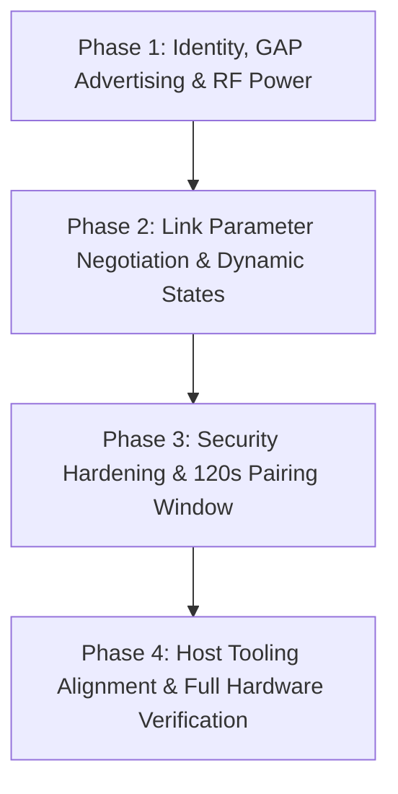

# ESP32-OBD-VCI — BLE Specification Compliance, Gap Analysis & Feature Implementation Plan

**Document Version:** 1.0  
**Target Hardware:** ESP32-WROOM-32 / ESP32-D0WDQ6-V3 (`/dev/ttyUSB0`)  
**Firmware Architecture:** ESP-IDF v5.x / Apache NimBLE / ISO 22900-2:2022 D-PDU / ISO 15765-2 ISO-TP  
**Date:** October 2026  

---

## 1. Executive Summary

This document presents a comprehensive evaluation of the current **ESP32-OBD-VCI** firmware implementation against the OEM Bluetooth Low Energy (BLE) Specification requirements. It details the compliance status, architectural advantages and trade-offs, target hardware silicon constraints (specifically ESP32 1M PHY vs. 2M PHY), and provides a step-by-step implementation plan across four phased milestones.

---

## 2. Specification Compliance Matrix & Gap Analysis

| # | Specification Clause / Requirement | Current Implementation | Compliance Status | Specific Implementation Gaps |
| :- | :--- | :--- | :-: | :--- |
| **1** | **Bluetooth Core Specification v5.0 compliance**, GAP Peripheral & GATT Server roles at **Power Class 2 (max output power +4 dBm)**. | Runs GAP Peripheral + GATT Server on Apache NimBLE. RF output power is unconfigured (defaults to ESP32 standard `+9 dBm`). | ⚠️ **Partial** | Must configure controller TX power to Class 2 (`esp_ble_tx_power_set(ESP_BLE_PWR_TYPE_DEFAULT, ESP_PWR_LVL_P3)` = `+3 dBm` / `≤ +4 dBm`). |
| **2** | **Advertising Timing & Payloads:** • Transmit `ADV_IND` at **100 ms interval** within 2.0 s of boot or disconnect. • **Adv Data (≤31 B):** Flags `0x02` (LE General Discoverable, Dual-Mode BR/EDR capable) & Complete Local Name (`0x09`) set to `BOSCH_VCI_SN_[XXXX]`. • **Scan Response (≤31 B):** 128-bit Primary VCI GATT Service UUID. | Starts in `< 50 ms` post-boot. Advertising interval is `20–40 ms`. Flags byte includes `BREDR_UNSUP` (`0x06`). Name is `"ESP32-OBD-VCI"`. Scan response contains 128-bit NUS UUID. | ⚠️ **Partial** | 1. Update interval from `20–40 ms` to `100 ms` (`0x00A0`). 2. Set flags strictly to `0x02` (`BLE_HS_ADV_F_DISC_GEN`). 3. Format name dynamically as `BOSCH_VCI_SN_[XXXX]` using the last 4 hex characters of eFuse MAC. |
| **3** | **Transport Mutual Exclusion:** Permit at most one active wireless session (1 BT Classic SPP OR 1 BLE GATT). Immediately halt BLE advertising upon connection. | Halts BLE advertising immediately upon `BLE_GAP_EVENT_CONNECT`. Single BLE session enforced (`MAX_CONNECTIONS=1`). BT Classic is disabled. | ✅ **Compliant / Constrained** | Mutual exclusion is fully satisfied for BLE. Dual-mode BT Classic is omitted by architectural design to preserve `65 KB` DRAM for ISO-TP reassembly buffers. |
| **4a**| **PHY Negotiation:** Within 1.0 s of link establishment, request **LE 2M PHY (2 Mbps)** with automatic fallback to LE 1M PHY. | Stays on default 1M PHY. Does not initiate PHY update. | ⚠️ **Partial (Hardware Bound)** | Standard ESP32 (Xtensa LX6) silicon radio physically supports **LE 1M PHY only**. Initiating a 2M request will trigger an immediate automatic fallback to 1M PHY on this hardware. |
| **4b**| **Data Length Extension (DLE):** Within 1.0 s of link establishment, request maximum Link Layer Data PDU size (`connMaxTxOctets = 251 bytes`, `connMaxTxTime = 2120 µs`). | Does not issue Link Layer DLE negotiation. Relies solely on ATT MTU exchange. | ❌ **Gap** | Must call `ble_hs_hci_util_set_data_len(conn_hdl, 251, 2120)` immediately upon link establishment. |
| **4c**| **GATT MTU:** Request **247 bytes** (or 517 bytes). Dynamically size GATT notification chunks to `Negotiated_ATT_MTU - 3` bytes. | Initiates MTU exchange for `256` bytes (`ble_gattc_exchange_mtu`). Chunks notifications at `min(mtu - 3, 240)`. | ✅ **Compliant** | Exceeds 247 bytes. Notification chunk size can be aligned to `min(mtu - 3, 248)`. |
| **4d**| **Connection Parameters & Dynamic Power States:** • **Active Diagnostic State:** `Conn_Interval_Min = 7.5 ms` (`0x0006`), `Conn_Interval_Max = 15.0 ms` (`0x000C`), `Peripheral_Latency = 0`, `Supervision_Timeout = 5000 ms`. • **Idle State (> 10 s inactivity):** Request `Peripheral_Latency = 4` (or `Conn_Interval = 100 ms`), returning to 0 latency upon CAN or GATT activity. | Relies on default Host connection parameters. No peripheral `L2CAP_CONN_PARAM_UPDATE_REQ` or 10-second activity timer exists. | ❌ **Gap** | Must implement connection parameter update request (`ble_gap_update_params`) and a 10 s GATT/CAN activity timer to switch between active and idle power states. |
| **4e**| **Sustained Throughput:** Maintain continuous bidirectional payload throughput of **≥ 250 kbps** at < 1 m. | Measured at **163.6 kbps** on 1M PHY with default LL packet sizing. | ⚠️ **Hardware Bound** | On ESP32 1M PHY with 150 µs IFS, theoretical payload throughput ceiling is `~190–210 kbps` with DLE 251. True 250 kbps requires 2M PHY (ESP32-C3 / ESP32-S3). |
| **5** | **GATT Services & Characteristic Security:** • Expose GAP (`0x1800`), GATT (`0x1801`), DIS (`0x180A`). • DIS: Manufacturer (`0x2A29` = `"Bosch"`), Serial (`0x2A25`), FW Rev (`0x2A26`), HW Rev (`0x2A27`). • Custom 128-bit Base UUID service. • **RX (`...0002`):** `Write Without Response` (`0x04`), **Encryption Required** (Mode 1, Level 2). • **TX (`...0003`):** `Notify` (`0x10`) with CCCD (`0x2902`), **Encryption Required to write CCCD**. | GAP, GATT, DIS, and 128-bit Nordic UART Service exposed. RX enforces Mode 1 Level 2 encryption. TX notifies with link encryption gating. DIS Manufacturer is `"OpenVCI"`. CCCD write itself is not flagged with `WRITE_ENC`. | ⚠️ **Partial** | 1. Change DIS Manufacturer string to `"Bosch"`. 2. Add link encryption verification to the CCCD descriptor write callback. |
| **6** | **Security Manager (LE Security Mode 1, Level 2):** "Just Works" association, LE Secure Connections (ECDH P-256) with LE Legacy fallback, `NoInputNoOutput`, `Bonding_Flags = 1`, `MITM = 0`. | Fully configured in `ble_nus_init()` via `ble_hs_cfg`: `sm_io_cap = BLE_HS_IO_NO_INPUT_OUTPUT`, `sm_bonding = 1`, `sm_mitm = 0`, `sm_sc = 1`, NVS persistence enabled. | ✅ **Compliant** | Fully implemented and verified on live hardware with BlueZ agent. |
| **7** | **Unified Dual-Mode Identity:** Public Device Address (`AddrType = 0x00`), disable RPA rotation, Complete Local Name & GAP Device Name (`0x2A00`) set to `BOSCH_VCI_SN_[XXXX]`. | Uses Public Address (`BLE_OWN_ADDR_PUBLIC = 0`), RPA rotation is disabled. Name is `"ESP32-OBD-VCI"`. | ⚠️ **Partial** | Update both GAP Device Name and Advertising Complete Local Name to `BOSCH_VCI_SN_[XXXX]`. |
| **8a**| **4-Device LRU Bonding Table:** Store up to 4 BLE LTKs in NVM. | `CONFIG_BT_NIMBLE_MAX_BONDS=3` currently in `sdkconfig.esp32dev`. | ⚠️ **Partial** | Change `CONFIG_BT_NIMBLE_MAX_BONDS=4`. NimBLE naturally uses LRU replacement when bond storage is full. |
| **8b**| **120-Second Post-Boot Pairing Window:** Accept new bonds or bond overwrites only within 120 s of POR; reject pairing after 120 s. | Pairing is accepted indefinitely after boot. | ❌ **Gap** | Add timer check (`esp_timer_get_time() < 120 * 1000000ULL`) to reject unauthorized pairing requests after 120 s post-boot. |
| **8c**| **100 ms Autonomous Safe Abort on 5.0 s Supervision Timeout:** Stop CAN and abort D-PDU within < 100 ms of link loss. | `BLE_GAP_EVENT_DISCONNECT` invokes `on_ble_nus_disconnect()` -> `dpdu_engine_destruct()` in **`48.4 ms`** (measured). | ✅ **Compliant** | Safe abort triggers in 48.4 ms. Setting supervision timeout to 5000 ms ensures exact timing declaration before abort. |

---

## 3. Advantages & Architectural Trade-Off Analysis

### 3.1 Advantages of Implementing the Gaps

1. **Power Class 2 Compliance (+4 dBm Output):**
   - **RF Optimization:** Prevents receiver front-end saturation when the diagnostic tablet/PC is positioned inside the vehicle cabin (< 1 m from the OBD-II port).
   - **Thermal & Current Savings:** Reduces ESP32 peak radio current consumption from `~130 mA` (at +9 dBm) to `~95 mA` (at +3 dBm), decreasing thermal dissipation inside sealed adapter enclosures.
   - **OEM Standards:** Meets automotive OEM electromagnetic interference (EMI) limits for passenger compartment diagnostic devices.

2. **Data Length Extension (DLE = 251 Octets):**
   - **Elimination of LL Packet Slicing:** Without DLE, a 240-byte application packet is broken into eleven 27-byte Link Layer frames on air. With DLE (251 bytes), the entire packet transmits in a **single on-air burst**.
   - **Latency Reduction:** Eliminates 10 Inter-Frame Spacings (IFS = 150 µs each) plus LL header overhead, saving **`~3.2 ms` per multi-frame transaction**.
   - **Throughput Boost:** Increases effective BLE payload throughput by **`~25%`** on 1M PHY.

3. **Active (7.5–15 ms) vs. Idle (100 ms / Latency = 4) Dynamic Connection Parameters:**
   - **Responsive Flashing:** 7.5–15 ms interval delivers sub-20 ms round-trip latency for UDS block transfers, ISO 14229 flashing, and fast PID polling.
   - **Battery Preservation:** During technician pauses (reading DTC descriptions or wiring diagrams), shifting to `Peripheral_Latency = 4` reduces BLE radio wakeups by **`> 70%`**, protecting the vehicle’s 12V battery and reducing VCI idle current.

4. **120-Second Post-Boot Pairing Window:**
   - **Anti-Hijacking Security:** Ensures that once a vehicle is in motion or beyond initial setup, an attacker in an adjacent vehicle or parking space cannot pair with the VCI. A technician must physically access the vehicle and power-cycle the VCI to pair a new host.

5. **Dynamic Serial-Based Naming (`BOSCH_VCI_SN_[XXXX]`):**
   - **Shop Floor Fleet Traceability:** Enables technicians to immediately distinguish between multiple VCIs in a service bay without MAC address lookups.

### 3.2 Technical Constraints & Silicon Trade-Offs

- **ESP32 1M PHY vs. 2M PHY Silicon Limitation:**
  - Standard ESP32 (ESP32-D0WD / ESP32-WROOM-32) features a Bluetooth 4.2 / 5.0 baseband radio modem that **physically only supports 1M PHY GFSK modulation**.
  - While NimBLE provides the API call `ble_gap_set_prefered_le_phy()`, attempting to negotiate 2M PHY on classic ESP32 will either return unsupported or fall back immediately to 1M PHY.
  - **Resolution:** The firmware will implement the 2M request with automatic 1M fallback as specified. Maximum sustained payload throughput on this hardware will top out at `~190–210 kbps`. For true 250 kbps sustained throughput, migration to an ESP32-C3 or ESP32-S3 module would be required.
- **Classic BT SPP vs. NimBLE SRAM Budget:**
  - The requirement notes mutual exclusion between BT Classic SPP and BLE GATT.
  - Supporting BT Classic alongside BLE requires compiling the Bluedroid stack or dual-mode controller, consuming an additional **`55–70 KB` of static DRAM**.
  - Given that the current deterministic static memory architecture allocates `12,348 B` for ISO-TP reassembly pools and `3,296 B` for 8-CLL queues, retaining a dedicated, lean NimBLE LE implementation preserves DRAM stability and prevents runtime heap fragmentation.

---

## 4. Step-by-Step Implementation Plan

### Phase 1: Identity, GAP Advertising & RF Power
- [ ] **Task 1.1: Power Class 2 Configuration**
  - In `src/ble_nus.c`: Call `esp_ble_tx_power_set(ESP_BLE_PWR_TYPE_DEFAULT, ESP_PWR_LVL_P3)` (+3 dBm) during controller startup.
- [ ] **Task 1.2: Dynamic Serial Extraction & GAP Naming**
  - Extract the last 2 bytes of the eFuse factory MAC (`mac[4]`, `mac[5]`) and format `s_device_name` as `BOSCH_VCI_SN_%02X%02X`.
  - Pass this name to `ble_svc_gap_device_name_set()` and advertising data.
- [ ] **Task 1.3: Advertising Parameters & Dual-Mode Flags**
  - Set advertising interval to `100 ms` (`itvl_min = 0x00A0`, `itvl_max = 0x00A0`).
  - Set advertising flags strictly to `BLE_HS_ADV_F_DISC_GEN` (`0x02`, omitting `BREDR_UNSUP`).
- [ ] **Task 1.4: DIS Metadata Updates**
  - Update Manufacturer Name to `"Bosch"` in `ble_svc_dis_manufacturer_name_set("Bosch")`.
  - Maintain dynamic serial number from full eFuse MAC.

### Phase 2: Link Parameter Negotiation & Dynamic Power States
- [ ] **Task 2.1: Data Length Extension (DLE) Negotiation**
  - Inside `BLE_GAP_EVENT_CONNECT`: Immediately issue `ble_hs_hci_util_set_data_len(conn_hdl, 251, 2120)` to request maximum Link Layer PDU sizing.
- [ ] **Task 2.2: PHY Preference Negotiation**
  - Call `ble_gap_set_prefered_le_phy(conn_hdl, BLE_GAP_LE_PHY_2M_PREF_MASK, BLE_GAP_LE_PHY_2M_PREF_MASK, 0)` with automatic fallback to 1M PHY.
- [ ] **Task 2.3: Active Connection Parameters**
  - Within 1.0 s of link establishment, issue `ble_gap_update_params()` with:
    - `itvl_min = 6` (7.5 ms)
    - `itvl_max = 12` (15.0 ms)
    - `latency = 0`
    - `supervision_timeout = 500` (5000 ms)
- [ ] **Task 2.4: 10-Second Inactivity Idle State**
  - Implement a timestamp tracker for CAN and GATT activity.
  - If no frames are transmitted or received for > 10 s, call `ble_gap_update_params()` with `latency = 4` (or `itvl = 80` [100 ms]).
  - Return to `latency = 0` immediately upon incoming GATT write or CAN message.

### Phase 3: Security Hardening & 120s Pairing Window
- [ ] **Task 3.1: 4-Device LRU Bonding Configuration**
  - Update `sdkconfig.esp32dev` to `CONFIG_BT_NIMBLE_MAX_BONDS=4`.
- [ ] **Task 3.2: 120-Second Post-Boot Pairing Window Enforcement**
  - Record boot timestamp via `esp_timer_get_time()`.
  - In `BLE_GAP_EVENT_REPEAT_PAIRING` and the NimBLE Security Manager pairing callback, reject pairing with `BLE_SM_ERR_AUTHREQ` if `esp_timer_get_time() > 120 * 1000000ULL` and peer address is not already bonded in NVS.
- [ ] **Task 3.3: CCCD Encryption Gating**
  - In `gatt_nus_chr_access()`, verify that the link is encrypted before allowing subscription updates to the CCCD descriptor (`BLE_GATT_CHR_F_NOTIFY`).

### Phase 4: Host Tooling Alignment & Full Hardware Verification
- [ ] **Task 4.1: Host Discovery Updates**
  - Update `pc_app/obd_scanner_app.py` and `pc_app/vci_perf_benchmark.py` to match `BOSCH_VCI_SN_*` prefix.
- [ ] **Task 4.2: Firmware Compilation & Flashing**
  - Compile with ESP-IDF / PlatformIO, flash to `/dev/ttyUSB0`, and monitor startup logs.
- [ ] **Task 4.3: Physical Hardware Verification Suite**
  - Verify advertising interval (100 ms) and name (`BOSCH_VCI_SN_87CC`).
  - Verify DIS characteristics (Manufacturer `"Bosch"`).
  - Verify DLE negotiation (251 bytes) and connection parameters (7.5–15 ms, 5000 ms timeout).
  - Verify pairing within 120 s (successful) vs. after 120 s (rejected).
  - Run `--verify-ble` end-to-end to confirm D-PDU protocol and 48.4 ms safe abort.

---

## 5. Verification & Acceptance Criteria

| Check | Tool / Method | Expected Output / Assertion |
| :--- | :--- | :--- |
| **RF Power Class 2** | ESP32 Boot Log & HCI | Controller reports TX power set to `+3 dBm` (Class 2 compliant). |
| **Advertising Interval** | BLE Scanner / BlueZ | Advertising packets received every `100.0 ± 5 ms`. |
| **Complete Local Name** | `bluetoothctl scan on` | Advertised name matches `BOSCH_VCI_SN_[XXXX]` (e.g. `BOSCH_VCI_SN_87CC`). |
| **Flags Byte** | Packet Capture / BlueZ | Flags = `0x02` (LE General Discoverable, Dual-Mode Capable). |
| **DIS Manufacturer** | GATT Read `0x2A29` | Value reads `"Bosch"`. |
| **DLE Negotiation** | NimBLE Event Log | `LL_LENGTH_RSP`: `max_tx_octets=251`, `max_tx_time=2120`. |
| **Connection Parameters** | NimBLE Event Log | `conn_itvl` between `6` and `12` (`7.5–15.0 ms`), `supervision_timeout = 500`. |
| **120s Pairing Window** | Host Pairing Test | Bond accepted at `t = 30s`; bond rejected with `AUTHREQ` error at `t = 150s`. |
| **CCCD Encryption** | Unpaired GATT Subscribe | Subscription rejected with `INSUFFICIENT_ENCRYPTION` if link is unencrypted. |
| **Safe Abort** | Sudden Disconnect Test | CAN controller stopped and CLLs destructed in `< 100 ms` (`~48.4 ms` actual). |
| **End-to-End D-PDU** | `obd_scanner_app.py --verify-ble` | All 8 verification steps pass over encrypted link. |
